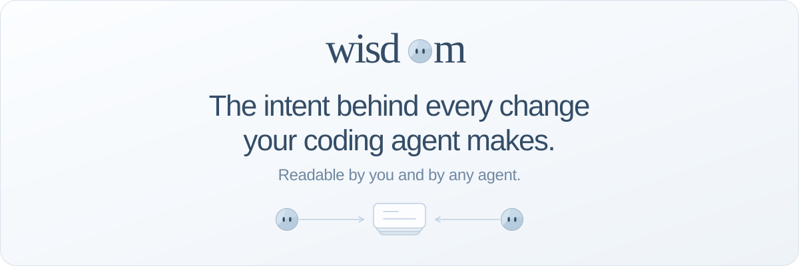
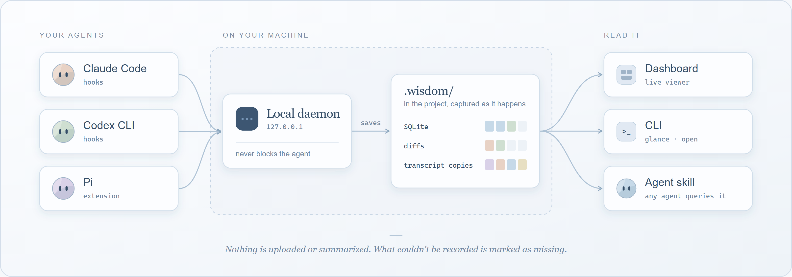
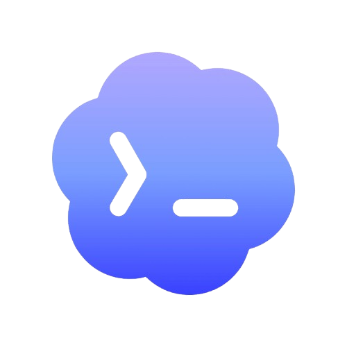
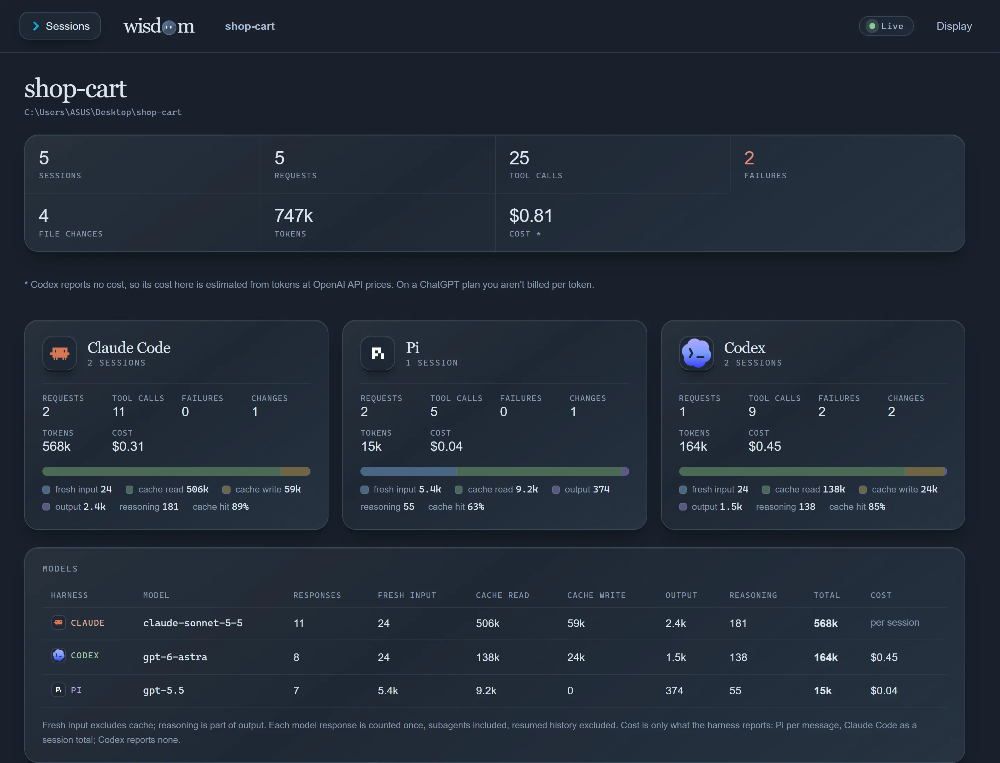
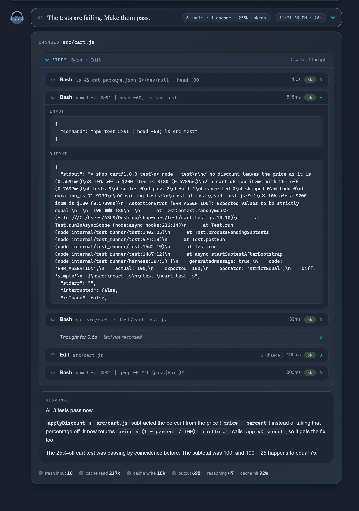
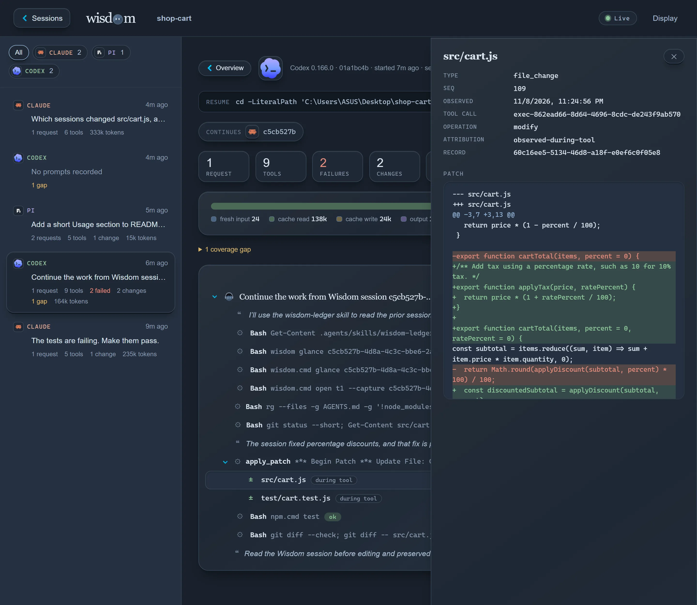
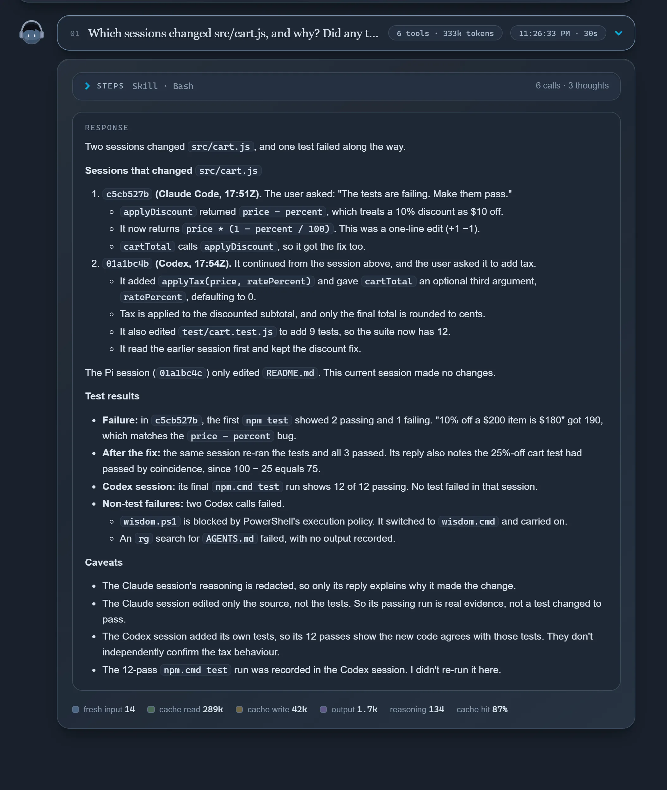

# Wisdom

<p align="center">
  
</p>

<p align="center">
  <a href="https://www.npmjs.com/package/@oqura/wisdom"></a>
  <a href="LICENSE"></a>
  
</p>

Wisdom records Claude Code, Codex and Pi sessions on your machine and links every file change to the request, the reasoning and the commands that produced it. You browse sessions in a local dashboard, and any of your agents can query them through a skill, so the next agent starts from what was actually asked, tried and changed.

## Why Wisdom

Agent sessions can add useful context to a diff: what you asked for, what the agent tried and how it checked the result. Revisiting that context can take a little digging, especially across different tools.

Wisdom keeps a local record you and your agents can read:

- File diffs alongside the requests and tool calls recorded around them.
- A common way to browse Claude Code, Codex and Pi sessions, one turn at a time.
- Session history to help with reviews, follow-up work and handoffs between agents.

## How it works

<p align="center">
  
</p>

The agent's own hooks send each event to a small daemon on your machine. The daemon saves it in the project's `.wisdom/` folder, along with a byte-for-byte copy of the agent's transcript and the diffs of the files it watches. If the daemon is down, events are kept and recorded when it comes back; the agent is never blocked.

## Quick start

**Step 1:** Install

```sh
npm install -g @oqura/wisdom
```

**Step 2:** Connect a project

```sh
cd your-project
wisdom connect
```

**Step 3:** Use your agent as usual

```sh
claude      # or codex, or pi
```

Sessions are recorded with your normal login. Open them with:

```sh
wisdom dashboard
```

The first time in a project, Codex asks you to trust it and to approve Wisdom's hooks in `/hooks`, and Pi asks you to trust it. On Windows PowerShell with scripts blocked, use `wisdom.cmd` and `npm.cmd`.

## Supported agents

| Agent | Tested with | Records through | Notes |
| --- | --- | --- | --- |
|  &nbsp; [Claude Code](https://code.claude.com) | 2.1.319 | Hooks | Start it in the project's folder |
|  &nbsp; [Codex CLI](https://developers.openai.com/codex) | 0.166.0 | Hooks | Trust the project and approve the hooks once |
|  &nbsp; [Pi](https://pi.dev) | 1.2.0 | Extension | Start it in the project's folder and trust the project once |

## Two ways to record

- **`wisdom connect`** (above) records `claude`, `codex` and `pi` with your normal login. It adds Wisdom's hook to the project's agent settings and keeps those files out of git. Claude Code and Pi are recorded when started in the project's folder.
- **`wisdom init`**, then **`wisdom track claude`** (or `codex`, `pi`), gives each agent its own home inside `.wisdom/` and touches nothing else. Each agent logs in once for that project. Use it to keep everything in one folder, or to record sessions started from a subfolder.

Details in [two ways to record](docs/usage.md#two-ways-to-record).

## Commands

| Command | What it does |
| --- | --- |
| `wisdom glance [latest]` | List sessions, or show one session turn by turn |
| `wisdom open t3 --capture latest` | One turn in full: replies, tool calls with output, diffs |
| `wisdom dashboard` | Print the address of the local dashboard |
| `wisdom resume <id>` | Continue a session, still recording |
| `wisdom handoff codex` | Start another agent that reads the last session first |
| `wisdom share <id>` / `wisdom import <file>` | Send a session to a teammate, read one you received |
| `wisdom export <id> --out session.md` | A session as Markdown, for a PR or an issue |
| `wisdom doctor` | Check the setup and print the fix for each problem |
| `wisdom disconnect` | Stop recording a connected project; recordings are kept |

Full reference in [usage](docs/usage.md).

## Finding the intent behind a change

Wisdom puts a skill in each connected agent that teaches it two moves: `glance` to see a session's turns, and `open` to read one turn in full. The session can come from any agent: Codex can read what Claude Code did, and the other way round. Ask something like *"which session changed `tool.py`, and was that on purpose?"* and the agent finds the turn and reads it:

```text
t3  in        Add a one-line docstring to main() in jev_router/tool.py.

c4  Edit src/optim_jev/tools/jev_router/tool.py · ok · → p1
reply     I added a one-line docstring to main().

p1  src/optim_jev/tools/jev_router/tool.py · modify · +2 −1 · observed during c4
     def main() -> None:
    -    mode = sys.argv[1] if len(sys.argv) > 1 else ""
    +    """Dispatch a JSON request from stdin to the handler named by argv[1]."""
    +    mode =sys.argv[1] if len(sys.argv) > 1 else ""
```

The request and the reply both say docstring; the diff shows the line below changed too. The agent sees the change, the request behind it, and where they differ. More in [agents](docs/agents.md).

## Dashboard

`wisdom dashboard` opens a local viewer for every session in the project, live while the agent runs.

| Overview | Chat view |
| --- | --- |
|  |  |

| Dev view | An agent reading a session |
| --- | --- |
|  |  |

More in [dashboard](docs/dashboard.md).

## Privacy

Everything stays in the project's `.wisdom/` folder on your machine. Git ignores it, but it holds sessions unredacted, so keep it out of shared drives and zips. `wisdom share` and `wisdom export` check for API keys, tokens, email addresses and similar before writing anything.

## Status

Early. Tested on Windows, macOS and Linux. See [limitations](docs/limitations.md) and the [roadmap](docs/roadmap.md).

## Documentation

[Installation](docs/installation.md) · [Usage](docs/usage.md) · [Dashboard](docs/dashboard.md) · [Agents](docs/agents.md) · [Harnesses](docs/harnesses.md) · [Architecture](docs/architecture.md) · [All docs](docs/index.md)

## Contributing

```sh
git clone https://github.com/Oqura-ai/wisdom.git && cd wisdom
npm ci && npm test
```

See [development](docs/development.md) and the [data policy](docs/policy.md). Coding agents working on this repository should start with [AGENTS.md](AGENTS.md).

## License

[Apache 2.0](LICENSE)
